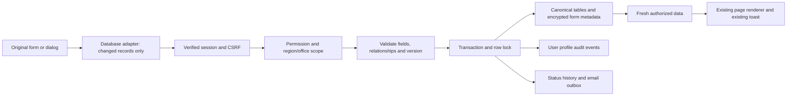
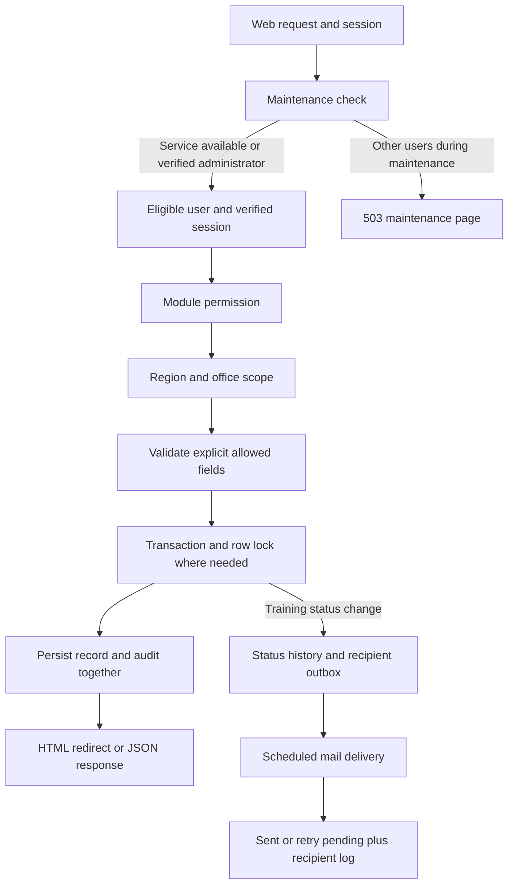
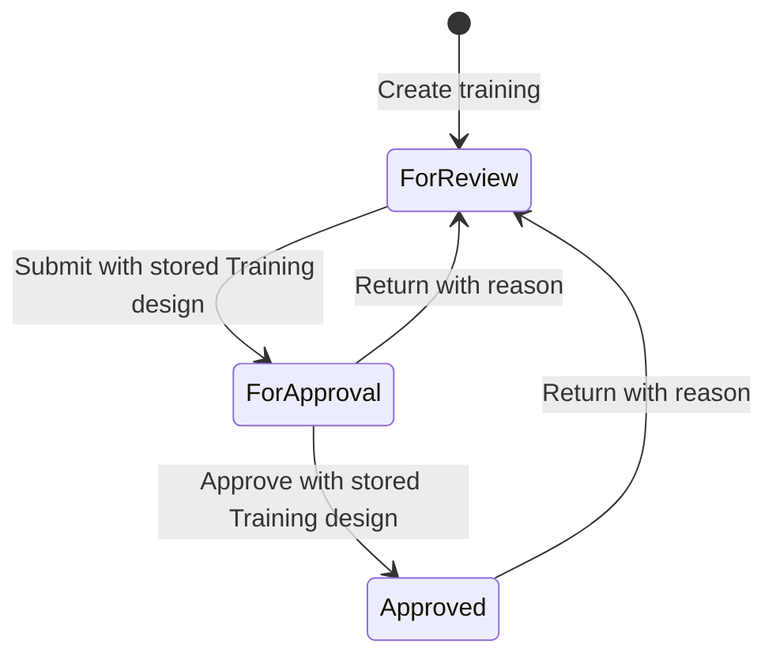

# TMIS backend, database and process flow

Implementation date: 6 November 2026. Runtime inspected: Laravel 13.39.0, PHP 8.3, PostgreSQL, PHPUnit 12.5.42. The existing interface uses Bootstrap 5.3.8. No dependency versions were changed.

## Entry points and module coverage

UI preservation correction: the original dashboard, charts, module layouts and navigation are restored. The added operations navigation bar and forced redirects were removed at the user's request. Backend endpoints and database/security changes remain available. Existing screen-to-backend integration must preserve the original markup, styles, interactions and toast notifications.

| Module / original page family | Working backend and page behavior |
| --- | --- |
| Dashboard | Scoped active counts for each permitted operational module; no sample chart values |
| Training registration, edit, view, all statuses, approved, inactive, review and approval | `/operations/trainings`; create and edit records, dates, budget, venue, type, delivery mode, target participants, partner organization, year and location; filter and paginate; attachments, enrollment and explicit status transitions |
| Resource person register, edit, view, active and inactive lists | `/operations/resource_persons`; name, contact, expertise, qualifications, title and organization; create, edit, deactivate and administrator trash |
| Participant register, edit, view and active/inactive lists | `/operations/participants`; contact, demographics, location, association membership and encrypted optional sensitive requirements |
| Farmer association register, edit, view and active/inactive lists | `/operations/associations`; type, short name, registration date, year and location; create, edit, deactivate and administrator trash |
| Pre-test, post-test, training evaluation and resource person evaluation questionnaires | `/operations/questionnaires`; typed questionnaire, ordered questions, office ownership; create and edit; questionnaires with submitted responses are immutable |
| Evaluation encoding and encoded-response lists | `/operations/evaluations`; approved training, enrolled participant, active office questionnaire and one complete response per training/questionnaire/participant |
| Notification pages | `/operations/notifications`; only the current recipient's persisted training status notifications; read/unread and mail delivery state |
| Account registration | Existing administration registration form and validated account creation/password-setup mail flow |
| Account lists, approval, edit, inactive and trash | `/system/accounts`; administrator changes role, office, region, approval and activation; account trash/restore; self access changes blocked |
| User profile | Existing personal-information and authentication flow retained |
| User profile logs | Existing `/app/admin/users/logs` URL now shows server-recorded events where the current user is subject or actor; no other users' records |
| System settings | `/system/settings`; maintenance, region/office visibility, new roles and permission editing |

Authenticated original module URLs render their existing Blade screens. The shared database adapter reads server-injected, permission-scoped records and submits explicit changes through `/ui/sync`; business records no longer use localStorage as their source of truth. Theme, table preferences and temporary undo state can remain in browser storage. Layouts, existing dialogs, navigation styling and toast rendering are retained. System settings are available through the original profile menu. The formerly empty account trash page now uses the same application shell and database-backed restore actions.

Original public IDs (`TRN-*`, `FMR-*`, questionnaire IDs and generated UUIDs) map to numeric database keys through `ui_id`. Never treat a browser-supplied office, role, ID, score or status as authorization. The server validates the module permission, ownership, relationships and current version independently.

The incomplete-training list currently means **missing Training Design**, the mandatory attachment identified in the request. It does not invent other mandatory documents. Pre/post questionnaires record item counts and manually encoded correct-answer scores; automatic answer marking has no supplied answer-key contract. Geographic fields retain the original selectors and available prototype hierarchy; region and office selection comes from active database reference records. A complete nationwide barangay master-data import has not been supplied. Budget reports derive allocated training budgets; releases and utilization remain "Not recorded" because the application has no ledger for those amounts. These are explicit data boundaries, not fabricated report values.

## Original-screen backend adapter

- [OriginalInterfaceData](app/Support/OriginalInterfaceData.php) projects authorized database rows into the field names expected by the original renderers. Canonical IDs, names, versions, status, membership, attachments and assignments override client metadata.
- [OriginalInterfaceController](app/Http/Controllers/OriginalInterfaceController.php) validates collection deltas, encrypts supplementary form data, delegates canonical CRUD and workflow checks, and persists score/rating responses, notification drafts and recipient state. A stale `_version` receives 409; deleted records are retained for administrator recovery.
- [OriginalDocumentController](app/Http/Controllers/OriginalDocumentController.php) handles private training/association/participant documents and highlight images. MIME/content, extension and size checks precede storage. Changes lock the owning training and recheck review status. Preview routes enforce scope and ownership.
- [original-interface.js](resources/js/shared/original-interface.js) awaits successful server responses before replacing its record cache. Existing page scripts continue to render their own tables, tabs and dialogs. Failures do not become success notifications.



The original encoding forms support standalone questionnaires. An explicit `trainingId` context binds a response to a specific training; otherwise the server associates it only when exactly one active approved training matches the participant enrollment, answer date, assigned pre/post questionnaire and assigned resource person where applicable. Ambiguous matches are rejected. No match remains a standalone result. Completed contextual responses require approved active training and cannot duplicate the same training/questionnaire/participant/resource-person combination; editing the existing response is supported. Detail tabs aggregate actual contextual responses and show empty states when none exist.

## Code flow



- [Routes](routes/web.php) define web/session/CSRF-protected endpoints. JSON is requested using `Accept: application/json`; this project already uses session-authenticated endpoints rather than a separate API token system.
- [EnsureSystemAvailable](app/Http/Middleware/EnsureSystemAvailable.php) checks administrator-configured maintenance after the session starts. Public sign-in, staff verification and password recovery display maintenance too. Administrator recovery sign-in remains at `/maintenance/sign-in`; only verified administrators or pending administrator challenges can continue. Logout and infrastructure health checks remain available. Administrator bypass requires account eligibility, the verified-user session and the password fingerprint.
- [EnsureEligibleUser](app/Http/Middleware/Authentication/EnsureEligibleUser.php) preserves existing authentication guarantees and applies [EnsureModuleAccess](app/Http/Middleware/EnsureModuleAccess.php) for legacy page restrictions and routing.
- [ModuleAccess](app/Support/ModuleAccess.php) defines the permission allowlist and office ownership queries. Unknown permissions are denied for non-administrators.
- [OperationsController](app/Http/Controllers/OperationsController.php) handles module data, explicit field validation, private documents, training enrollment, status transitions, evaluations, notifications and own activity logs.
- [OperationalFields](app/Support/OperationalFields.php) defines the additional module fields shared by forms and server validation. It does not replace request authorization.
- [SystemSettingsController](app/Http/Controllers/SystemSettingsController.php) handles administrator-only role grants, account access, maintenance and personal visibility filters.
- [AuditTrail](app/Http/Authentication/AuditTrail.php) writes redacted user activity. Training changes also write `trainings_log`. Sensitive participant details are never included in these before/after snapshots.
- [TrainingNotificationDelivery](app/Support/TrainingNotificationDelivery.php) claims outbox records under a database lock, sends mail, records delivery state and logs success or failure for the recipient.
- [DeliverTrainingNotifications](app/Console/Commands/DeliverTrainingNotifications.php) processes a bounded batch of 100 notifications. [Console routes](routes/console.php) register it every minute with overlap protection.
- [Operations JavaScript](resources/js/shared/operations.js) handles office option filtering, question/answer inputs, deletion confirmation and calls the unchanged existing `TmisToast.show(message, type)` component.

## Authorization and roles

No user-role policy document was found in the repository. Existing database role names alone do not define their responsibilities. Consequently, the implementation deliberately seeds no operational grants for non-administrator roles. A System Administrator must configure them using the actual approved policy before staff use.

| Capability | System Administrator | Other roles |
| --- | --- | --- |
| Operational records | Full access | Explicit per-module `read` or `write` grant, own region AND office only |
| Submit training | Full access | `trainings.submit` |
| Approve or return training to review | Full access | `trainings.approve` |
| Delete records | Administrator-only soft deletion | Denied even if a fabricated permission is submitted |
| Accounts, roles, settings and maintenance | Full access | Denied |
| Activity logs and notifications | Own profile logs, own notifications; existing administrator audit viewer available | Own profile logs and own notifications |
| Cross-region operational visibility | All by default; optional personal region and office filters | Cannot override assigned scope |

Grant the matching `read` permission when granting write, submit or approve access, so the user can open the corresponding page. Module names are `trainings`, `participants`, `associations`, `resource_persons`, `questionnaires` and `evaluations`.

The System Administrator role is protected from editing through role management. Administrators cannot delete or modify their own account access through account administration. Staff cannot elevate themselves through profile update payloads. Account deletion retains the user and audit records and sets `deleted_at` plus inactive status; restore keeps the account inactive until explicitly reactivated.

Administrator visibility settings store multiple region IDs and office IDs per administrator. An empty selection means all. When both selections are supplied, every office must belong to a selected region. The scope is applied to record lists, lookups, evaluations and dashboard counts; it does not remove administrator privileges. Clear the filters to see records outside a previous selection.

## Training lifecycle and documents



Actual status strings are `For review`, `For approval` and `Approved`. A new record always starts in review. Payloads cannot set status during ordinary create/edit operations. Dates must be ordered; budgets cannot be negative. A record's owning region and office cannot change after creation.

1. Register the association, participant and resource person as needed.
2. Create the training in its implementing office. Save it to obtain its database ID.
3. Open the training and enroll active participants/resource persons from that same office and region.
4. Upload the training design with attachment type **Training design**. Documents are limited to PDF/DOC/DOCX, matching file content and filename extension, with a 10 MB limit.
5. Submit to **For approval** using the current version. The server locks the training, validates the transition and checks that a design actually exists on the private local disk.
6. An authorized approver approves it or returns it to review with a reason. Approved records may also return to review with a reason.
7. Status, version, history, audit and recipient outbox rows commit atomically. A stale version receives HTTP 409 and creates no duplicate status event or mail records.
8. Edit fields, attachments or enrollment only while in review. Only approved, active trainings accept evaluations.

Files are stored under the private local filesystem, not public assets. Download routes check training permission and scope and bind the attachment to its training. A failed upload transaction deletes its newly stored file. Soft-deleting a training retains document and evaluation references for auditability.

## Evaluations

Questionnaires contain an ordered JSON array of question text and one of four kinds: Pre-test, Post-test, Training evaluation, Resource person evaluation. Responses contain an equally sized ordered answer array. The server requires an approved active training, an active questionnaire in the same office/region and an active participant enrolled in that training. Duplicate responses are rejected with HTTP 409. Submitted questionnaires cannot be edited to reinterpret existing responses.

Answers are currently text. There is no automatic marking, numerical summary, question-choice schema or individual resource-person subject on a response. Those features require an agreed evaluation/scoring design.

## Email and notifications

The current recipient assumption is **every active, approved user in the training's region and implementing office whose role is active**. Inactive or rejected accounts and other offices are excluded. This is not a designated shared office mailbox; change the recipient policy if the organization's division-office email rule requires one.

Every move to For approval, Approved or back to For review creates a status-change row and a unique `(status_change_id, user_id)` outbox row for each recipient. The email uses escaped HTML and a plain-text alternative. Credentials and attachments are not emailed.

Delivery is asynchronous through the scheduled command, using the configured mail transport (`smtp` in the inspected local configuration):

```sh
php artisan tmis:deliver-training-notifications --no-interaction
php artisan schedule:work
```

Use the first command to process one batch. Run the second only as the appropriate managed local worker; production should invoke `php artisan schedule:run` every minute using its normal scheduler/service. The schedule is defined in application code, but an operating-system scheduler/service was not installed by this work.

Failures remain pending with an attempt count and exponential retry delay capped at 60 minutes. Before sending, the worker rechecks account approval, activation, role activity, current email address and office/region membership. Changed recipients are cancelled rather than receiving stale office data. A process crash after SMTP accepts a message but before the database marks it sent can cause a duplicate on retry: this is at-least-once delivery, not exactly-once email delivery. `sent_at` means the mail transport accepted the send operation, not that a recipient opened the email or that downstream delivery was guaranteed.

## Maintenance

System settings let an administrator choose Live or Under maintenance, a public message and an optional return time. Date entry uses the configured application timezone, shown beside the field. The maintenance page formats the expected return in Asia/Manila. Passing the return time automatically resumes ordinary requests even if the stored toggle remains enabled. Choosing Live clears the return time.

Blocked users receive HTTP 503, `Retry-After: 60` and `Cache-Control: no-store`. Administrators can still authenticate and return to settings. This is application maintenance; it depends on the database being available. Infrastructure outages should use the web server's independent maintenance/error handling.

## Database schema and ERD

The complete executable schema is in the [base migration](database/migrations/2026_11_05_084116_create_updated_tmis_schema.php) and the additive [operational migration](database/migrations/2026_11_06_015441_create_tmis_operational_tables.php). The [Mermaid ERD](TMIS-ERD.mmd) describes keys, cardinalities and representative columns; the migrations remain authoritative for all columns, types, indexes, defaults and foreign keys.

All five operational record tables share: numeric `id`, `region_id`, `org_id`, `created_by`, `name`, nullable `description`, `is_active`, `created_at`, `updated_at`, `deleted_at`. All ownership and creator IDs have foreign keys. Region/office/deletion indexes support scoped lookups; trainings also index region/office/status. Records are soft-deleted so foreign-key relationships and audit history remain intact.

| Table | Additional columns / responsibility |
| --- | --- |
| `region` | `region_id` PK, name, active flag, timestamps |
| `organization` | `org_id` PK, `region_id` FK, name, details, active flag, timestamps |
| `user_roles` | `role_id` PK, name, details, active flag, timestamps |
| `users` | `user_id` PK; case-insensitive unique email; personal and contact fields; role, region and office FKs; position; email verification, approval and activation; profile photo; creation/update timestamps; new nullable `deleted_at` |
| `user_auth` | Unique user FK, password hash, two-factor state, challenge/token state, attempts, resend/expiry/login timestamps |
| `user_verify` | Unique user FK, code hash, session binding hash, attempts, resends, expiry/invalidation timestamps |
| `password_reset_tokens` | Email PK, reset-token hash and timestamp; existing broker behavior |
| `role_permissions` | Composite PK `(role_id, permission)`; role FK; no deletion/system-settings grants available |
| `system_settings` | Singleton ID 1, maintenance flag, public message, return time, timestamps |
| `user_data_scopes` | User PK/FK; nullable JSON region/office ID lists; null means all for an administrator |
| `associations` | Short name, organization type, district/province/municipality/barangay, year covered, registration date |
| `participants` | Nullable association FK, first/middle/last names/suffix, email/phone/telephone, date of birth, sex, address, nationality, birthplace, house/street/postal code, location, association role; encrypted `protected_details` |
| `resource_persons` | Title, first/middle/last names/suffix, qualification, organization, email, phone, expertise |
| `trainings` | Start/end dates, venue, decimal budget, workflow status, version; training type, delivery mode, partner organization, target participant count, year and location |
| `questionnaires` | Kind and ordered JSON questions |
| `training_attachments` | Training FK, attachment kind, generated private path, original filename, MIME type, size, uploader FK, timestamps |
| `training_participant` | Composite PK training/participant FKs |
| `training_resource_person` | Composite PK training/resource-person FKs |
| `evaluation_responses` | Training, questionnaire, participant and encoder FKs; ordered JSON answers; timestamps; unique training/questionnaire/participant |
| `training_status_changes` | Training and actor FKs; previous/new statuses, optional reason, timestamp |
| `training_notifications` | Status-change and recipient FKs; email snapshot, attempts, retry/sent/read/cancelled timestamps, creation time; unique event/recipient |
| `users_log` | Subject user and actor FKs; event, category, outcome, description, redacted JSON before/after, metadata, IP, user agent, request UUID, creation time |
| `trainings_log` | Existing public/string training reference and actor FK; same audit context columns |
| `farmers_log` | Existing public/string farmer reference and actor FK; same audit context columns; retained for compatibility |
| `migrations` | Laravel migration tracking |

The legacy string references in `trainings_log` and `farmers_log` are not foreign keys to numeric operational IDs. New training events write the numeric ID as a string and also write the user's activity event. Existing historical logs remain intact.

`protected_details` encrypts optional 4Ps, disability, indigenous group, tribe, dietary restriction, allergy and senior-citizen information using Laravel application encryption. Ciphertext is never sent to the browser. The original-screen bootstrap decrypts demographic fields only for users granted participant read access, inside the selected region/office scope. Keep the application encryption key in protected backups; losing it loses access to these fields. Sensitive fields are excluded from automatic validation-input flashing and audit snapshots.

## Verification and production status

This work is not a production certification. Local tests cover permission checks, cross-office reads/downloads, validation, state transitions, missing training designs, stale status versions, private file handling, enrollment-dependent evaluations, account administration, custom roles, region filters, maintenance, activity isolation, mail content and durable retries. Existing authentication and page tests are also run. PostgreSQL schema tests use temporary transaction-scoped schemas and roll back.

Commands for repeatable verification:

```sh
php artisan test --compact
php artisan test --compact tests/Feature/OperationsTest.php
npm run build
composer audit --no-interaction
```

The workspace has no Git metadata, so `pint --dirty` cannot run. Formatting is applied to the explicit changed PHP file list instead. No additional test packages were installed. Existing older JavaScript browser tests reference missing pre-Laravel paths and an uninstalled `playwright-core` package; they are not evidence of a passing end-to-end browser suite.

Production gates still open:

1. Supply and apply the approved role policy; confirm the division-office recipient rule.
2. Resolve Composer security advisories, with the dependency-change approval required by the project. The inspected audit found 8 advisories affecting `symfony/http-foundation`, `symfony/http-kernel`, `symfony/mime`, `symfony/routing` and `symfony/yaml`.
3. Supply a reproducible JavaScript dependency lockfile and run a full dependency audit, including externally loaded frontend assets. `npm audit` currently cannot run without a lockfile.
4. Test real SMTP delivery in staging and provision/monitor the application scheduler. Mail tests use a fake transport and do not prove inbox delivery.
5. Complete authenticated staging browser acceptance with representative roles, data volumes and the documented geographic/reporting boundaries.
6. Check HTTPS, production debug/session settings, backups and restore, private file permissions, upload scanning policy, encryption-key retention and representative load in the actual hosting environment.

The migration has been applied to the local database without replacing existing user/reference data. Do not run `migrate:fresh` on a real database. The operational migration's rollback drops its new data tables and the account deletion marker; use a verified backup and a deliberate forward fix once real operational data exists.

## Prepared dependency remediation (approval required)

A dry run of the following command completed without changing dependencies:

```sh
composer update symfony/http-foundation symfony/http-kernel symfony/mime symfony/routing symfony/yaml --with-dependencies --no-scripts --no-interaction
```

| Package | Installed | Proposed |
| --- | --- | --- |
| symfony/http-foundation | 7.4.21 | 7.4.23 |
| symfony/http-kernel | 7.4.21 | 7.4.23 |
| symfony/mime | 7.4.19 | 7.4.22 |
| symfony/routing | 7.4.21 | 7.4.23 |
| symfony/yaml | 7.4.21 | 7.4.23 |
| symfony/error-handler | 7.4.20 | 7.4.22 |
| symfony/var-dumper | 7.4.21 | 7.4.22 |
| symfony/deprecation-contracts | 3.7.1 | 3.8.1 |
| symfony/event-dispatcher-contracts | 3.7.1 | 3.8.1 |
| symfony/polyfill-mbstring | 1.43.0 | 1.43.3 |

The last five updates are dependency requirements of the proposed patch updates. The dry run's audit still reports installed vulnerable versions because the dry run does not install replacements. After approval, apply the updates, rerun the audit and full tests, and review any remaining advisories. Separately approve creation of an npm lockfile before relying on an npm audit result.

A browser smoke check using the actual served toast and operations scripts confirmed that a success message uses the existing toast, selecting a region hides and disables offices from other regions, adding a questionnaire item creates an editable input, and selecting a questionnaire creates its answer fields. This was a frontend fixture check, not an authenticated end-to-end acceptance test.

## Final verification result

- Full PHP suite with isolated PostgreSQL schema coverage enabled: **264 passed, 1 skipped**, 2,507 assertions after original-screen integration. The skipped PostgreSQL SQL-dump import test requires an external dump fixture (`TMIS_IMPORT_TEST_DUMP`) that was not provided.
- The operational suite and original-screen integration suite cover backend boundaries; the final run includes both.
- Frontend production asset build and operational JavaScript syntax check passed.
- All Blade templates compiled successfully.
- Local operational migrations are applied (batches 2, 3 and 4); maintenance is left disabled by default.
- Existing toast source and styles were reused without modification.
- No real training-status emails were sent during verification; mail delivery was faked in tests.


## UI preservation correction

The original dashboard was recovered from its existing HTML source, retaining its original charts, cards, carousel, desktop/mobile navigation and assets, with Blade asset/route resolution and authenticated account bindings. The added global operations bar was removed. Page authorization no longer redirects users to generic forms. The original activity-log screen uses server-recorded events through its existing layout and renderer. Backend schema, permissions and mutation endpoints were retained. Prior claims about full integration through replacement workspaces do not describe the restored UI. Further backend integration must use the existing screens without redesigning them.


## Additional original-form schema

[Original-interface migration](database/migrations/2026_11_06_035929_add_original_interface_data_to_operational_records.php) adds `ui_id`, encrypted `ui_data` and `ui_version` to the five operational record tables. Ownership remains normalized; encrypted metadata stores supplementary original form fields such as intervention entries and highlight bullets. It is not used to authorize a request.

| Table | Main fields and relationships |
| --- | --- |
| `assessment_results` | Unique `ui_id`; questionnaire FK; nullable participant, resource-person and training FKs; region/office/encoder FKs; answer date, score, commodity, draft/complete state, JSON ratings, comments, encrypted form metadata, version, timestamps and soft deletion |
| `training_questionnaire` | Composite primary key `(training_id, questionnaire_id)` and restrictive FKs |
| `user_notifications` | Unique public ID; batch ID; recipient/creator user FKs; title, summary, message, type, priority, reference, related page, read/archive timestamps |
| `user_interface_drafts` | Composite primary key `(user_id, draft_key)`; encrypted payload; notification composer draft and own recipient read/archive state |
| `association_attachments` | Association and uploader FKs; kind/year/remarks; private path, original filename, MIME, byte count and timestamps |
| `participant_attachments` | Participant and uploader FKs; same private-document metadata |
| `training_highlights` | Unique training/slide pair; validated JSON text/font/branding content; private image/logo paths and timestamps |
| `training_attachments` additions | Original display type, year and remarks; canonical `Training design` remains the submission gate |

[Attachment/highlight migration](database/migrations/2026_11_06_040927_add_interface_details_to_training_attachments.php) creates the document/highlight structures. [ERD](TMIS-ERD.mmd) includes these relationships. New migrations were applied locally without replacing existing users or reference records.

### Browser smoke checks

Original training view: all nine tabs opened without JavaScript errors using a test-rendered page. A real test response displayed Ana Santos, 4/5 and 80%, rather than synthesized sample scores. Original training edit and dashboard also loaded without JavaScript errors; the dashboard used scoped database counts. These checks used test-rendered fixtures and the real served scripts, with only the fixture document intercepted in a separate browser tab. They do not prove a real authenticated staging journey, external SMTP delivery, or production load capacity. The user's sign-in tab was left untouched.


## Final original-screen integration verification

- Full PHP regression suite: **264 passed, 1 skipped, 2,507 assertions**. The skip is the external SQL-dump fixture test; isolated PostgreSQL schema coverage ran.
- Original-interface integration suite: **12 passed**, covering private uploads, physical design-file gating, status history/outbox, enrollment, contextual assessments, duplicate responses, client score tampering, office isolation, stale versions, metadata permissions, original page permissions, account identity changes, reactivation, trash and restore.
- All 111 original JavaScript modules parse; the production asset build succeeds. Blade compilation succeeds. The optional font fallback optimizer reports its existing missing optional package; no dependency was added.
- All four migrations are recorded as applied in the local database. Existing toast implementation and styles were retained.
- Original training view/edit and dashboard browser fixtures passed without JavaScript errors. Fixtures and interception were cleared afterward; the user's shared sign-in page was not replaced.
- Real SMTP delivery, scheduler hosting, approved role-policy acceptance, dependency advisory remediation and authenticated staging acceptance remain production gates. This is not a production recommendation.


## Profile security and office management

Office creation, name/details updates and deletion use administrator-only `/system/offices` endpoints. Offices retain their region on edit; deletion rejects offices referenced by users, business records or visibility settings. The existing table updates and shared toasts run without a page refresh.

Profile photos use authenticated `/profile/photo` endpoints. JPG, PNG and WebP uploads are limited to 10 MB and 8000 pixels per dimension. Files live on the private local disk under the account ID, and a guarded response serves only the current user's image. Replacing/removing a photo deletes only that user's managed file. Missing photos use initials.

The Security panel calls `/profile/security` and its action endpoints. Authenticator enrollment requires the current password, encrypts a pending setup key and expires after ten minutes. A valid app code activates it and produces eight single-use recovery codes. Secrets and recovery hashes are encrypted; successful time-step counters prevent code replay. Disabling or replacing codes requires the current password plus an app/recovery code. Authenticator verification takes precedence at sign-in; disabling it leaves the existing email-verification setting intact. Setup uses a manual time-based key in the authenticator app.

`user_device_sessions` records actual authenticated sessions independently of Laravel's file session driver. Device tokens are stored only as hashes; the API exposes opaque row IDs instead of session credentials. Session lists are scoped to the current user and the configured inactivity lifetime; expired/revoked rows are excluded. Individual revocation is checked on subsequent protected requests. Signing out other sessions increments an account generation so even previously untracked sessions cannot return. The current session retains its new generation. Password changes preserve the current session and revoke others; password resets invalidate all prior sessions. Sensitive actions are CSRF-protected, throttled and logged to the current user's audit trail. Setup keys, passwords and recovery codes are never written to audit events.
